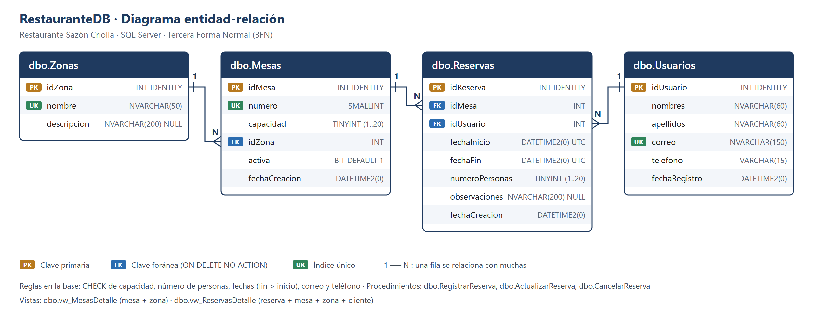
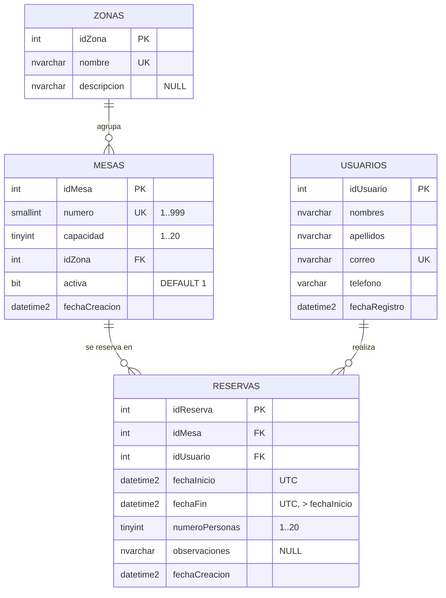

# EP-Laboratorio_BBDD · Base de datos SQL Server

Repositorio **2 de 3** del sistema de reservas del **Restaurante Sazón Criolla**. Contiene los scripts de
SQL Server: la estructura (DDL), la carga inicial (DML) y el diagrama de la base de datos.

| Repositorio | Contenido |
| --- | --- |
| [EP-Laboratorio_Backend](https://github.com/KlausGatjens/EP-Laboratorio_Backend) | API REST con Node.js + Express |
| **EP-Laboratorio_BBDD** (este) | SQL Server: tablas, índices, vistas, procedimientos almacenados y datos |
| [EP-Laboratorio_MongoDB](https://github.com/KlausGatjens/EP-Laboratorio_MongoDB) | MongoDB: esquemas de logs y comentarios y su carga inicial |

> Evaluación Parcial · Desarrollo Web Full Stack Backend · Universidad Autónoma del Perú

---

## Caso de negocio

El restaurante **Sazón Criolla** necesita un backend para gestionar sus **mesas**, sus **clientes** y las
**reservas** en tiempo real, sin que dos clientes reserven la misma mesa a la misma hora. Esta base de datos
guarda la información transaccional, donde se necesita integridad y consistencia (ACID).

| Concepto del enunciado | En este sistema |
| --- | --- |
| Salas | **Mesas** del restaurante, agrupadas en **Zonas** (salón, terraza, VIP, barra) |
| Usuarios | **Usuarios**: los clientes que reservan |
| Reservas | **Reservas**: un cliente reserva una mesa para un número de personas en un horario |

## Estructura del repositorio

```text
EP-Laboratorio_BBDD/
├── DDL/
│   ├── 01_creacion_tablas.sql            # Base RestauranteDB + 4 tablas con PK, FK, CHECK y DEFAULT
│   ├── 02_creacion_indices.sql           # Índices únicos y de búsqueda
│   ├── 03_creacion_vistas.sql            # vw_MesasDetalle y vw_ReservasDetalle
│   └── 04_procedimientos_almacenados.sql # RegistrarReserva, ActualizarReserva, CancelarReserva
├── DML/
│   └── 05_carga_inicial.sql              # INSERT de zonas, mesas, usuarios y reservas
├── PRUEBAS/
│   └── 06_pruebas_procedimientos.sql     # Demostración de cada regla del procedimiento
├── diagrama/
│   ├── diagrama_bd.png                   # Diagrama entidad-relación
│   └── diagrama_bd.svg                   # Mismo diagrama en formato vectorial
└── README.md
```

## Ejecución

### Requisitos

- SQL Server 2019 o 2022 (Express o Developer) y SQL Server Management Studio (SSMS).
- Para que la API se conecte: **autenticación SQL (modo mixto)** habilitada y **TCP/IP** activo en el puerto 1433.

### Pasos en SSMS

Abrir cada archivo y ejecutarlo completo (**F5**) **en este orden**:

| Orden | Archivo | Resultado |
| --- | --- | --- |
| 1 | `DDL/01_creacion_tablas.sql` | Crea la base `RestauranteDB` y las tablas |
| 2 | `DDL/02_creacion_indices.sql` | Crea los índices |
| 3 | `DDL/03_creacion_vistas.sql` | Crea las vistas |
| 4 | `DDL/04_procedimientos_almacenados.sql` | Crea los procedimientos almacenados |
| 5 | `DML/05_carga_inicial.sql` | Inserta los datos iniciales |
| 6 | `PRUEBAS/06_pruebas_procedimientos.sql` | *(Opcional)* Demuestra las reglas del negocio |

Todos los scripts son **re-ejecutables**. Para reiniciar la base desde cero, volver a ejecutar del 1 al 5.

### Alternativa por consola (sqlcmd)

```bash
sqlcmd -S localhost -U sa -P <clave> -C -i DDL/01_creacion_tablas.sql
sqlcmd -S localhost -U sa -P <clave> -C -i DDL/02_creacion_indices.sql
sqlcmd -S localhost -U sa -P <clave> -C -i DDL/03_creacion_vistas.sql
sqlcmd -S localhost -U sa -P <clave> -C -i DDL/04_procedimientos_almacenados.sql
sqlcmd -S localhost -U sa -P <clave> -C -i DML/05_carga_inicial.sql
```

## Diagrama de la base de datos





## Diccionario de datos

### `dbo.Zonas`: ambientes del restaurante

| Columna | Tipo | Restricciones | Descripción |
| --- | --- | --- | --- |
| idZona | INT IDENTITY | PK | Identificador |
| nombre | NVARCHAR(50) | NOT NULL, único, no vacío | Salón principal, Terraza, Zona VIP, Barra |
| descripcion | NVARCHAR(200) | NULL | Descripción del ambiente |

### `dbo.Mesas`: lo que se reserva

| Columna | Tipo | Restricciones | Descripción |
| --- | --- | --- | --- |
| idMesa | INT IDENTITY | PK | Identificador |
| numero | SMALLINT | NOT NULL, único, 1..999 | Número visible en el salón (101, 201...) |
| capacidad | TINYINT | NOT NULL, 1..20 | Máximo de comensales |
| idZona | INT | FK → Zonas | Zona a la que pertenece |
| activa | BIT | DEFAULT 1 | 0 = fuera de servicio (no se puede reservar) |
| fechaCreacion | DATETIME2(0) | DEFAULT SYSUTCDATETIME() | Fecha de alta (UTC) |

### `dbo.Usuarios`: clientes

| Columna | Tipo | Restricciones | Descripción |
| --- | --- | --- | --- |
| idUsuario | INT IDENTITY | PK | Identificador |
| nombres | NVARCHAR(60) | NOT NULL, no vacío | Nombres |
| apellidos | NVARCHAR(60) | NOT NULL, no vacío | Apellidos |
| correo | NVARCHAR(150) | NOT NULL, único, formato `x@y.z` | Correo de contacto |
| telefono | VARCHAR(15) | NOT NULL, 7 a 15 dígitos (admite `+`) | Teléfono |
| fechaRegistro | DATETIME2(0) | DEFAULT SYSUTCDATETIME() | Fecha de registro (UTC) |

### `dbo.Reservas`: un cliente reserva una mesa

| Columna | Tipo | Restricciones | Descripción |
| --- | --- | --- | --- |
| idReserva | INT IDENTITY | PK | Identificador |
| idMesa | INT | FK → Mesas | Mesa reservada |
| idUsuario | INT | FK → Usuarios | Cliente que reserva |
| fechaInicio | DATETIME2(0) | NOT NULL | Inicio (UTC) |
| fechaFin | DATETIME2(0) | NOT NULL, > fechaInicio | Fin (UTC) |
| numeroPersonas | TINYINT | NOT NULL, 1..20 | Comensales |
| observaciones | NVARCHAR(200) | NULL | Cumpleaños, silla para bebé, alergias... |
| fechaCreacion | DATETIME2(0) | DEFAULT SYSUTCDATETIME() | Fecha de registro (UTC) |

Todas las restricciones tienen **nombre** (`PK_`, `FK_`, `CK_`, `DF_`, `UX_`, `IX_`). Así los mensajes de error son
claros y la API puede identificar qué regla se violó.

## Normalización (3FN)

| Forma normal | Cómo se cumple |
| --- | --- |
| **1FN** | Todos los atributos son atómicos: `nombres` y `apellidos` van en columnas separadas, una reserva es una sola mesa en un solo intervalo y no hay listas ni grupos repetidos. |
| **2FN** | Cada tabla tiene una clave primaria simple (`id...`), por lo que no puede haber dependencias parciales de una parte de la clave. |
| **3FN** | Ningún atributo no clave depende de otro atributo no clave. El nombre y la descripción de la zona no se guardan en `Mesas` (dependerían de `idZona`, no de `idMesa`), sino en `Zonas`. `Reservas` solo guarda las claves foráneas: el número de mesa, la zona y el nombre del cliente se obtienen con JOIN en `vw_ReservasDetalle`. |

## Índices

| Índice | Tabla (columnas) | Para qué sirve |
| --- | --- | --- |
| `PK_*` (clúster) | cada tabla (`id...`) | Búsqueda por identificador |
| `UX_Zonas_nombre` | Zonas (nombre) | No repetir zonas |
| `UX_Mesas_numero` | Mesas (numero) | No repetir números de mesa |
| `UX_Usuarios_correo` | Usuarios (correo) | Un correo por cliente |
| `IX_Mesas_Zona` | Mesas (idZona) | Mesas de una zona y JOIN con Zonas |
| `IX_Reservas_Mesa_Fechas` | Reservas (idMesa, fechaInicio) | Detectar cruces de horario de una mesa (procedimiento) |
| `IX_Reservas_Usuario_Fechas` | Reservas (idUsuario, fechaInicio) | Cruces de horario de un cliente y sus reservas |
| `IX_Reservas_Fechas` | Reservas (fechaInicio) | Filtros por rango de fechas y mesas disponibles |

## Vistas

| Vista | Contenido |
| --- | --- |
| `dbo.vw_MesasDetalle` | Mesas con el nombre de su zona |
| `dbo.vw_ReservasDetalle` | Reservas con número de mesa, zona, nombre y correo del cliente |

## Procedimientos almacenados

### `dbo.RegistrarReserva` (registro de una reserva)

```sql
EXEC dbo.RegistrarReserva
    @idMesa = 3, @idUsuario = 2,
    @fechaInicio = '2026-12-18T01:00:00',  -- UTC (17/12/2026 20:00 en Lima)
    @fechaFin    = '2026-12-18T03:00:00',
    @numeroPersonas = 4,
    @observaciones = N'Cumpleaños';
```

Trabaja dentro de una **transacción** (`SET XACT_ABORT ON` + `TRY/CATCH` con `ROLLBACK`) y valida en orden:

1. Las fechas son válidas, están en el futuro, la reserva dura entre **30 minutos y 4 horas** y está dentro
   del **horario de atención (12:00 a 23:00, hora de Lima)**.
2. La mesa existe y está activa. La fila de la mesa se bloquea con `UPDLOCK, HOLDLOCK` hasta el `COMMIT`:
   si dos clientes intentan reservar la misma mesa a la vez, el segundo espera y luego ve la primera reserva
   (se evita la **condición de carrera**).
3. El usuario existe (también se bloquea, para que un cliente no haga dos reservas cruzadas a la vez).
4. El número de personas no supera la capacidad de la mesa.
5. La mesa no tiene otra reserva que se cruce: `inicioExistente < finNuevo AND finExistente > inicioNuevo`.
6. El cliente no tiene otra reserva que se cruce.
7. Inserta, confirma (`COMMIT`) y devuelve la reserva con los datos de la mesa y del cliente.

`dbo.ActualizarReserva` aplica las mismas reglas (excluyendo la propia reserva al buscar cruces) y
`dbo.CancelarReserva` elimina la reserva. Los dos solo permiten cambiar reservas que **todavía no empiezan**:
las pasadas se conservan como historial y son las que los clientes pueden reseñar en MongoDB.

### Códigos de error

Los procedimientos lanzan errores con `THROW`. La API los traduce a códigos HTTP:

| Código | HTTP | Mensaje |
| --- | --- | --- |
| 50001 | 400 | Las fechas de la reserva no son válidas |
| 50002 | 400 | No se puede reservar en una fecha u hora pasada |
| 50003 | 400 | La reserva debe durar entre 30 minutos y 4 horas |
| 50004 | 400 | La reserva está fuera del horario de atención |
| 50005 | 404 | La mesa no existe |
| 50006 | 409 | La mesa está fuera de servicio |
| 50007 | 404 | El usuario no existe |
| 50008 | 409 | La mesa admite como máximo N personas |
| 50009 | 409 | La mesa ya está reservada en ese horario |
| 50010 | 409 | El usuario ya tiene otra reserva en ese horario |
| 50011 | 404 | La reserva no existe |
| 50012 | 409 | La reserva ya inició o terminó: no se puede modificar/cancelar |

## Carga inicial

| Tabla | Registros | Detalle |
| --- | --- | --- |
| Zonas | 4 | Salón principal, Terraza, Zona VIP, Barra |
| Mesas | 12 | 101-105 salón, 201-203 terraza, 301-302 VIP, 401-402 barra (la **402 está fuera de servicio**) |
| Usuarios | 8 | Clientes de ejemplo |
| Reservas | 10 | 6 **pasadas** (1 a 6) y 4 **futuras** (7 a 10), calculadas desde el día en que se ejecuta el script |

Los identificadores son fijos porque la carga inicial de MongoDB tiene reseñas de las reservas pasadas 1 a 5.

## Fechas y zona horaria

Las fechas se guardan en **UTC** (`DATETIME2` + `SYSUTCDATETIME()`). La API recibe fechas ISO 8601 con zona
horaria (por ejemplo, `2026-12-17T20:00:00-05:00`) y el driver las convierte a UTC. Para validar el horario de
atención, el procedimiento resta 5 horas (Lima es UTC-5 todo el año, sin horario de verano).
